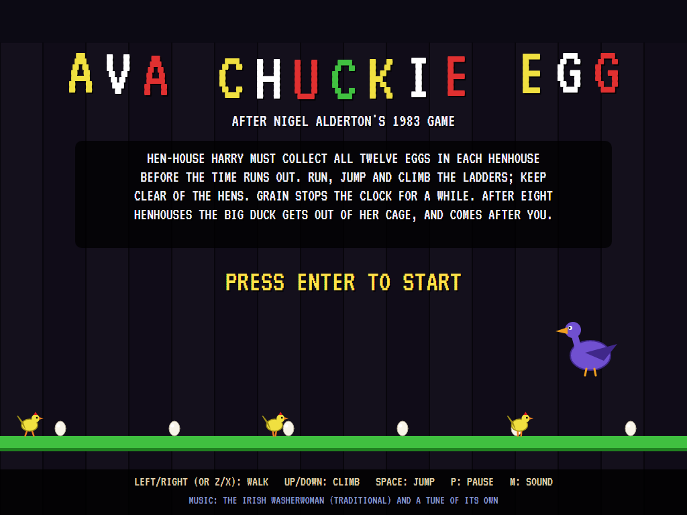
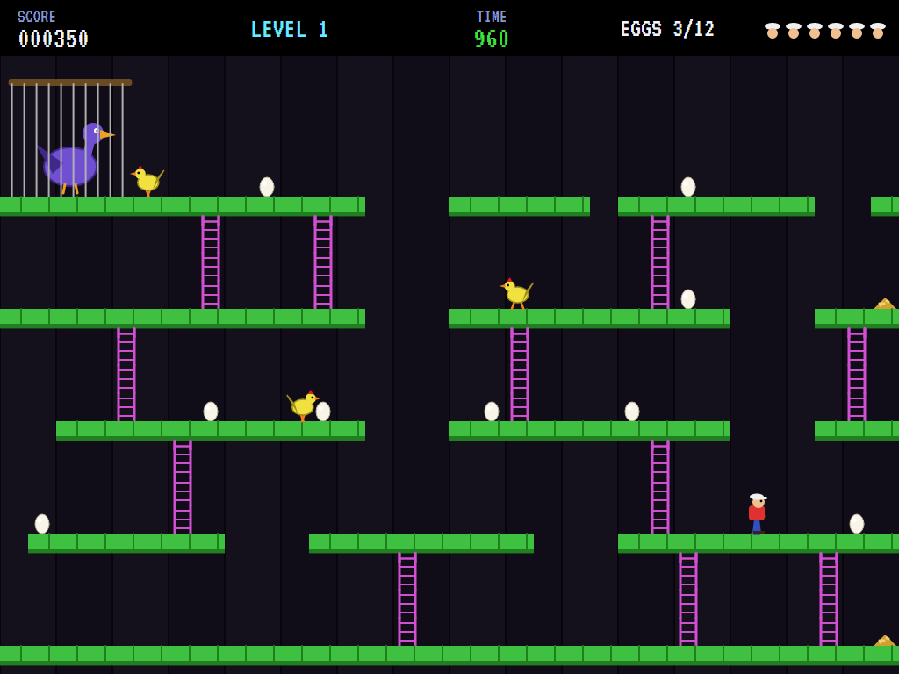
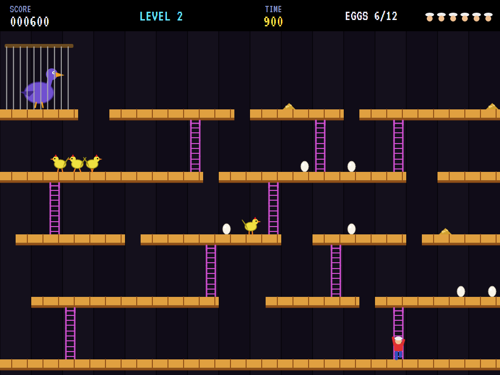
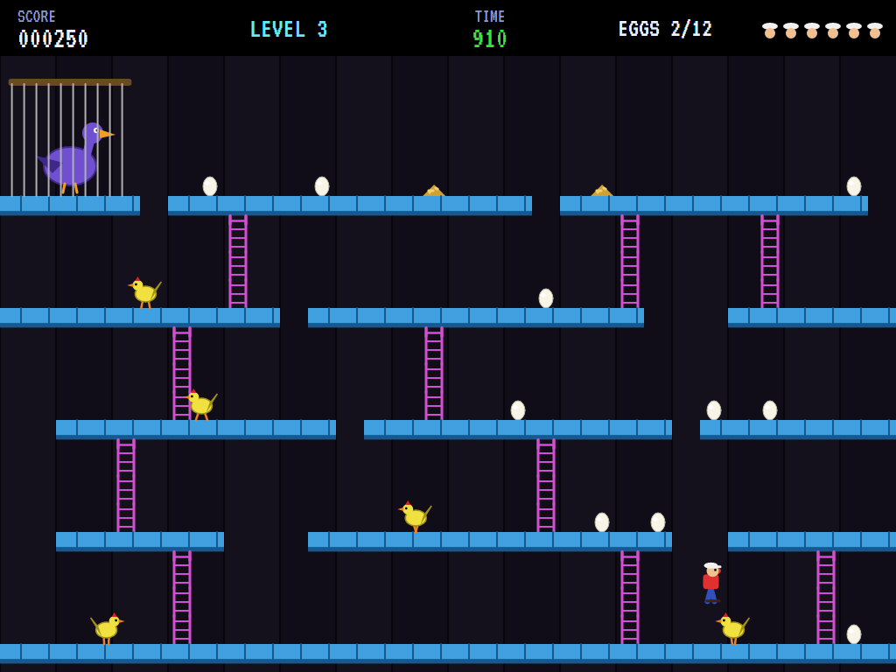
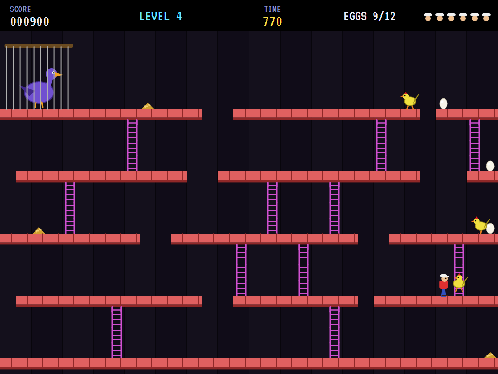
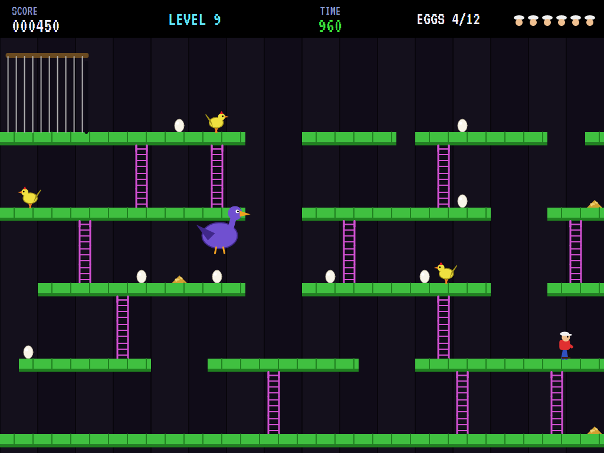
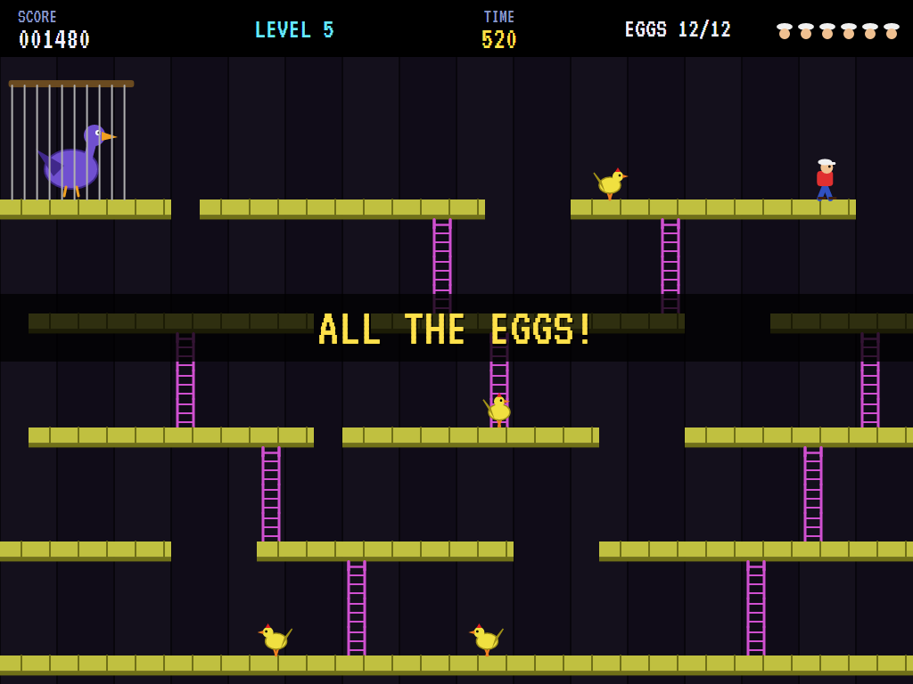
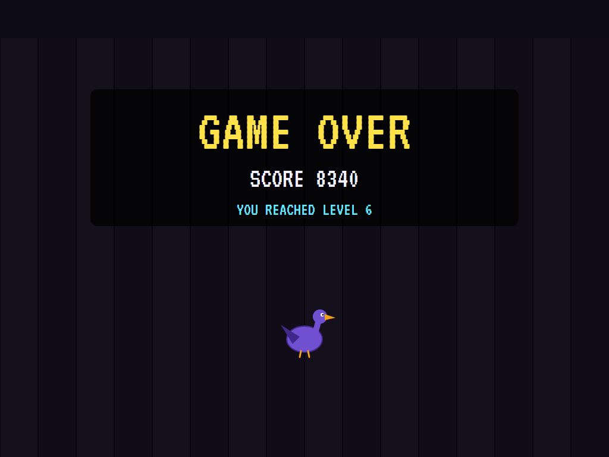
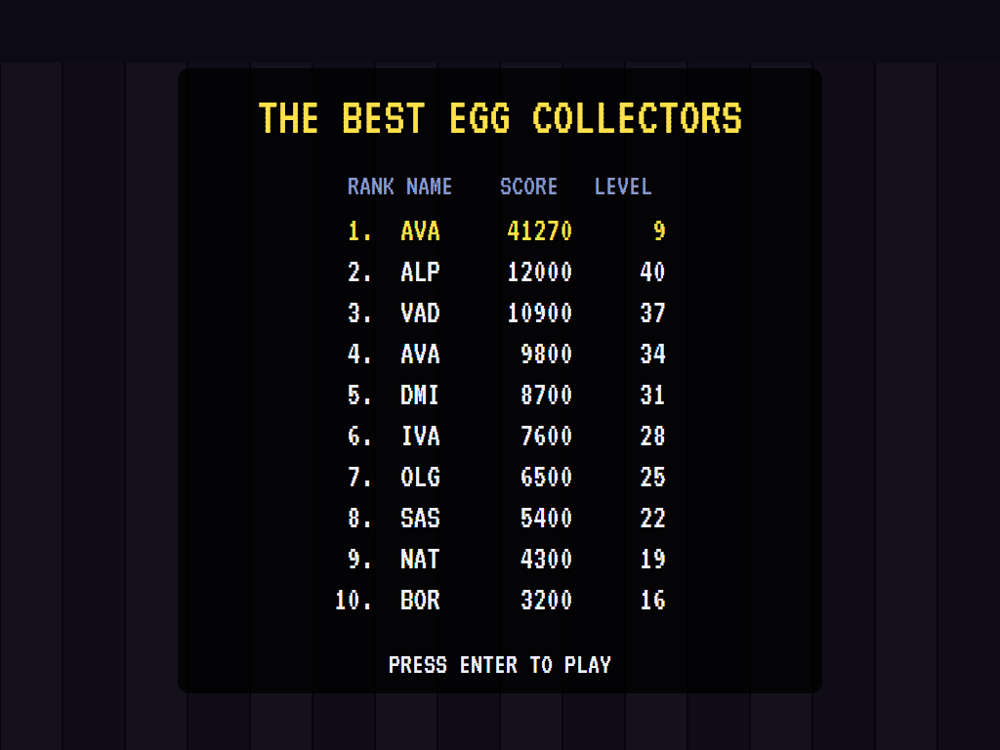

# AVA Chuckie Egg

[](https://github.com/Harlock123/AVAChuckieEgg/actions/workflows/build.yml)

A platform game round the henhouse in the style of Nigel Alderton's 1983 game **Chuckie Egg** (A&F Software),
built with .NET 10 and Avalonia UI. Hen-House Harry has to collect all twelve eggs in each henhouse before the
time runs out. Run, jump and climb the ladders, and keep clear of the hens. After eight henhouses the big duck
gets out of her cage and comes after him.

## Features

- **Eight henhouses**, then round again harder. Each is built from a seed: the ground, four floors of
  platforms broken into stretches, ladders between them, twelve eggs, piles of grain and the hens. A henhouse
  is kept only if every egg can be reached from the start. That's checked on a map of Harry's moves, each one
  tried in the game's own physics.
- **Harry** walks, jumps a fixed arc (up through a platform from below, and onto it), climbs the ladders
  (stepping off where there's floor), and catches hold of a ladder as he jumps past it. He can fall any
  distance onto a platform, but off the bottom of the henhouse is the end of him.
- **The hens** strut along their platforms, turn at the ends, go up and down the ladders as the fancy takes
  them, and stop to eat any grain they come to. Touch one and it's a life lost.
- **The big duck** watches from her cage at the top left. From the second round on she's out, flying straight
  for Harry through everything, a little faster every round.
- **Time** counts down by tens. Grain stops it for five seconds. Whatever's left when the last egg is taken is
  added to the score. Eggs are worth 100, more in later rounds, and grain 50; there's an extra life every
  10,000. Eggs taken stay taken when a life is lost.
- **The attract mode** shows the computer Harry at work. It knows every place it can stop in the henhouse and
  where each walk, jump and climb takes it, and plans the quickest way to the nearest egg (or grain) left.
  Before each move it plays the move out on a copy of the henhouse, hens, duck and all. If one would get it,
  it waits for the moment it wouldn't, or takes another way.

## Screenshots

| The title | The first henhouse | Up a ladder |
|:---------:|:------------------:|:-----------:|
|  |  |  |

| A jump | A hen close by | The duck is out |
|:------:|:--------------:|:---------------:|
|  |  |  |
| | | From the second round on. |

| Every egg | Game over | The best egg collectors |
|:---------:|:---------:|:-----------------------:|
|  |  |  |

The screenshots are made by the tests, which play the game in a real (headless) window; see
[Tests](#tests).

## Download and run

Ready-to-run builds for Windows, macOS and Linux, on both Intel/AMD and ARM, are on the
[Releases page](https://github.com/Harlock123/AVAChuckieEgg/releases/tag/latest). **Latest build** is
rebuilt on every push to `main`. Each download is one self-contained executable: no .NET install is
needed.

| Platform | Archive |
|---|---|
| Windows | `AVAChuckieEgg-win-x64.zip`, `AVAChuckieEgg-win-x86.zip`, `AVAChuckieEgg-win-arm64.zip` |
| macOS | `AVAChuckieEgg-osx-arm64.tar.gz` (Apple silicon), `AVAChuckieEgg-osx-x64.tar.gz` (Intel) |
| Linux | `AVAChuckieEgg-linux-x64.tar.gz`, `AVAChuckieEgg-linux-arm64.tar.gz`, `AVAChuckieEgg-linux-arm.tar.gz` |

```bash
tar -xzf AVAChuckieEgg-linux-x64.tar.gz     # or linux-arm64, linux-arm, osx-arm64, osx-x64
./AVAChuckieEgg
```

On Windows, unzip and run `AVAChuckieEgg.exe`. On macOS, if Gatekeeper refuses to open it, run
`xattr -d com.apple.quarantine AVAChuckieEgg` once. Run with `--no-audio` for silence.

**Sound** comes through OpenAL Soft, built in for every platform. In a virtual machine the game
detects it and uses a larger audio buffer, so the sound doesn't break up.

**Gamepads** use SDL2, which is bundled for Windows, macOS and Intel/AMD Linux. ARM Linux builds need it
installed; without it the keyboard still works:

```bash
sudo apt install libsdl2-dev            # Debian / Ubuntu / Raspberry Pi OS
sudo pacman -S --needed sdl2-compat     # Arch / Omarchy
```

## Controls

| Action | Keyboard | Gamepad |
|---|---|---|
| Start | Enter or 1 | Start |
| Walk | Left/right arrows, Z/X (as on the BBC Micro), or A/D | Left stick / D-pad |
| Climb | Up/down arrows, or W/S | Up / down |
| Jump | Space, Ctrl or Shift | A or B |
| Pause | P or Esc | Start |
| Sound on/off | M | |
| Screenshot | Ctrl+S (to your Pictures folder) | |

On the high-score table, type your initials, or use up/down and Space, then Enter.

## Tests

```bash
dotnet test AVAChuckieEgg.slnx
```

The game runs in fixed 60 Hz steps, so it plays the same at any frame rate. Everything that changes lives in
one world that can be copied. The tests check:

- **The henhouses:** the same from the same seed; twelve eggs in every one, all within reach of the start, and
  three to five hens.
- **Harry:** walking, and the fixed jump; up a ladder and off onto the platform; down from the top of one;
  falling safely off a platform but not off the bottom; jumping up through a platform onto it; eggs and grain,
  and the grain stopping the clock; the time running down by tens, and out.
- **Hens and the duck:** a hen walking her platform and turning at the ends, deadly to touch; hens climbing
  ladders and eating grain; the duck out from the second round, flying after Harry.
- **The game:** every egg taken, the time counted in, and on to the next henhouse; a life lost, with the eggs
  taken still gone; lives running out; the demonstration and high scores; pause; a copied world; the keys.
- **The computer Harry:** every egg in henhouses 1, 4 and 7; just running and jumping about doesn't get them.

`tests/AVAChuckieEgg.Tests/PilotProbe.cs` reports how the computer Harry gets on over the first sixteen
levels, for tuning (`EGG_PROBE=1`). It clears fifteen of them, and loses lives mostly to the duck in the
second round. `EGG_PROBE=lazy` runs and jumps about at random and clears none.

The screenshot tests draw the real screen in a headless window. To refresh the README's pictures:

```bash
EGG_SHOTS=$PWD/Images dotnet test tests/AVAChuckieEgg.Tests --filter ScreenshotTests
```

## Building

```bash
dotnet build AVAChuckieEgg.slnx
dotnet run --project src/AVAChuckieEgg
```

Needs the .NET 10 SDK. The sounds, music and voice are made by `tools/make_sounds.py` (standard-library
Python, with the formant voice in `tools/speech.py`): `python3 tools/make_sounds.py` rewrites
`src/AVAChuckieEgg/Sounds`.

## Project structure

```
AVAChuckieEgg/
├── AVAChuckieEgg.slnx
├── src/AVAChuckieEgg/
│   ├── Engine/
│   │   ├── GameEngine.cs        # States, levels and rounds, lives, the time tally, the demonstration
│   │   ├── Sim.cs               # The rules step by step: walking, jumping, ladders, eggs, grain, hens, the duck
│   │   ├── House.cs             # The eight henhouses, built from seeds and proved
│   │   ├── Graph.cs             # Every place Harry can stop, and where each move takes him
│   │   ├── World.cs             # Everything that changes, kept together so it can be copied
│   │   ├── Pilot.cs             # The computer Harry (the demonstration, and the tests)
│   │   ├── HighScoreTable.cs, InitialsEntry.cs
│   │   ├── InputHandler.cs, ControllerManager.cs  # Keys and an SDL2 gamepad
│   │   └── SoundManager.cs      # Effects, music and voice through OpenAL
│   ├── Audio/                   # The OpenAL engine (from the author's AVABand)
│   ├── Views/GameCanvas*.cs     # The henhouse, Harry, the hens and duck, the top line, the title
│   └── Sounds/                  # The synthesised effects, music and voice
├── tests/AVAChuckieEgg.Tests/   # Gameplay and screenshot tests
├── tools/make_sounds.py, tools/speech.py
└── Images/                      # Screenshots
```

## About and licence

AVA Chuckie Egg © 2026 Lonnie Watson, under the [MIT License](LICENSE).

*Chuckie Egg* © 1983 A&F Software (written by Nigel Alderton); the names *Chuckie Egg* and *Hen-House Harry*
belong to their current owner. AVA Chuckie Egg is an independent, unofficial game in its style. Its henhouses,
graphics, sounds and code are its own; nothing is taken from the original game's program, graphics or sound.
It is not affiliated with or endorsed by any rights holder. The Irish Washerwoman is a traditional tune,
arranged here from scratch.
